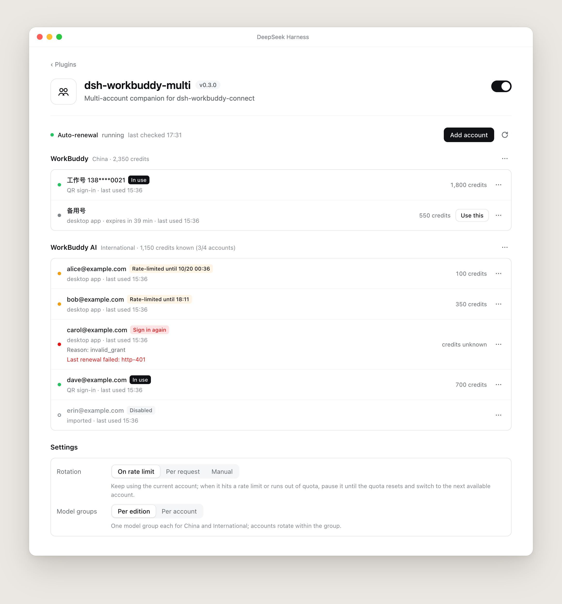
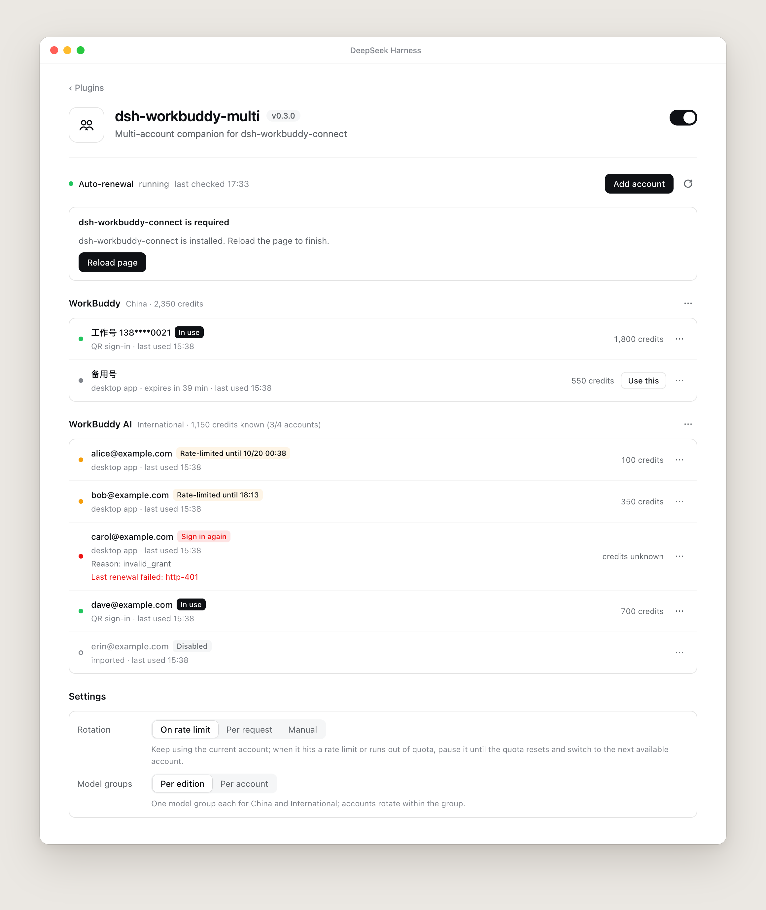
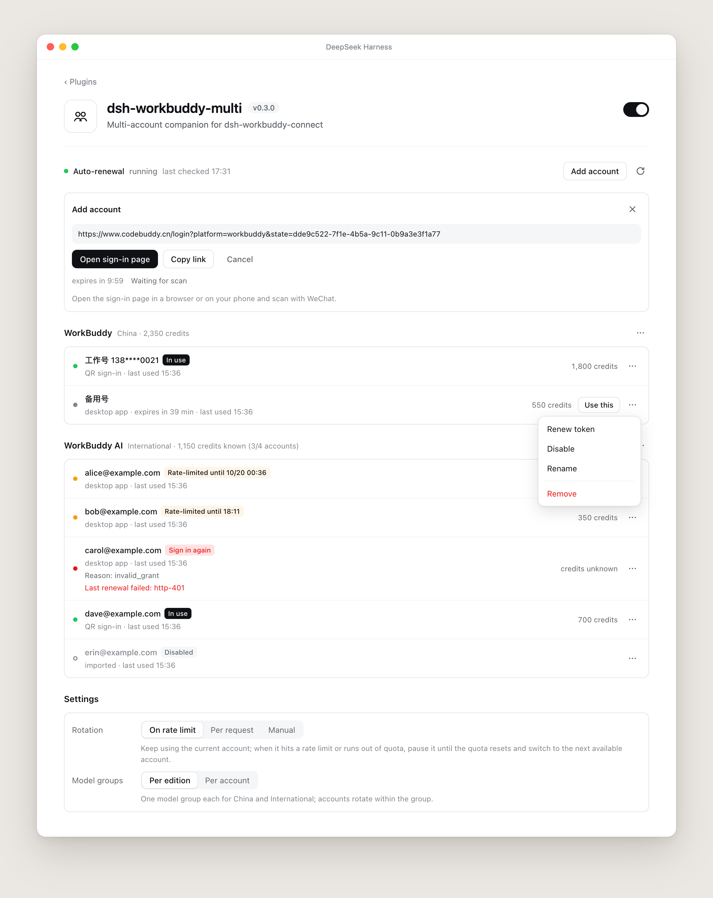
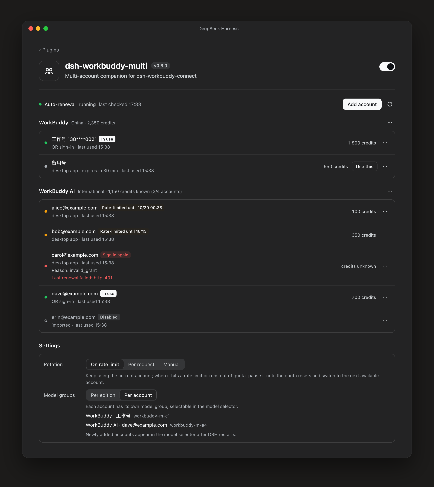

<h1 align="center">dsh-workbuddy-multi</h1>

<p align="center">
  Run several WorkBuddy accounts in DeepSeek Harness: automatic switching on rate limits, QR sign-in, automatic token renewal.
</p>

<p align="center">
  <a href="README.md">中文</a> · English
</p>

<p align="center">
  
</p>

A companion plugin for [dsh-workbuddy-connect](https://github.com/corrinehu/dsh-workbuddy-connect).
`dsh-workbuddy-connect` brings WorkBuddy's models into DSH; this plugin manages several accounts on top of it without modifying any of its files.

## Features

- **Account rotation** — one pool per edition (China and International). When an account hits a rate limit or runs out of quota, it is paused until the quota resets, and the next request goes straight to the next available account instead of trying the limited one again.
- **QR sign-in** — create an official WorkBuddy sign-in link in the settings page and scan it with WeChat. You can also import the account signed in to the desktop app, or import auth files.
- **Automatic token renewal** — tokens close to expiry are refreshed on a schedule; accounts that need to sign in again are flagged.
- **Credit totals** — credits of all enabled accounts are summed per edition and shown next to the composer.
- **Two grouping modes** — one model group per edition with rotation inside it, or one model group per account to pick directly in the model selector.
- **Dependency auto-install** — if `dsh-workbuddy-connect` is missing, it is installed through the plugin market.

## Install

**From the plugin market (recommended):** open DSH's Plugin Market, search for `dsh-workbuddy-multi`, and install.

**From the command line (dsh web):**

```sh
dsh plugin --profile web add https://github.com/richardhxwang/dsh-workbuddy-multi/releases/latest/download/dsh-workbuddy-multi.tgz
```

Reload the page, then open **dsh-workbuddy-multi** on the Plugins page.

### The dependency installs itself

This plugin needs `dsh-workbuddy-connect`. Once this plugin is installed from the plugin market it checks right away: if the dependency is missing, or installed but disabled, it installs or enables it through the plugin market and shows progress in a notice and on the settings page. Reload the page or restart DSH when prompted. If the automatic attempt fails, the notice shows the reason and a **Retry** button; for the next 6 hours it does not try again on its own, and the **Install** button starts it at any time.

<p align="center">
  
</p>

Without a plugin market nothing can be installed automatically; the settings page shows the command instead:

```sh
dsh plugin add dsh-workbuddy-connect
```

## Usage

### Add an account

Click **Add account**, choose China or International, create the sign-in link, open it in a browser or on your phone, and scan with WeChat. The account joins the pool as soon as sign-in succeeds.

The **⋯** menu next to each edition also offers:

- **Import current desktop app account** — reads the account signed in to the WorkBuddy desktop app.
- **Import auth files** — enter the paths of auth files.

<p align="center">
  
</p>

Each account's **⋯** menu has Renew token, Disable / Enable, Rename and Remove. **Use this** appears only on accounts that can be used right now.

### Rotation

| Mode | Behavior |
| --- | --- |
| **On rate limit** (default) | Keep using the current account; on a rate limit or empty quota, pause it until the quota resets and switch to the next available account. |
| **Per request** | Each request uses the next available account. |
| **Manual** | Never switch automatically; only the account set as current is used. |

The pause lasts until the reset time WorkBuddy reports; when it reports none, the pause is 30 minutes.

### Model groups

| Mode | Behavior |
| --- | --- |
| **Per edition** (default) | One model group for China and one for International; accounts rotate inside it. |
| **Per account** | Each account has its own model group in the model selector. New accounts appear after DSH restarts. |

<p align="center">
  
</p>

## Notes

- **Leave the auth file fields in dsh-workbuddy-connect's settings empty.** `authFile` / `authFileAI` take priority over this plugin, and rotation stops working when they are set. The settings page warns when it detects them.
- **China-edition accounts only work on this computer.** Their credentials are encrypted with the local WorkBuddy app's key.
- **Credentials stay on this computer** in `~/.dsh/workbuddy-pool/` (mode 0600). Neither the settings page nor its API ever shows or returns a token.
- China-edition accounts imported from the desktop app are renewed by `dsh-workbuddy-connect` when used. Sign them in once with **Add account** to have them renewed automatically too.

## Configuration

Usually unnecessary. To change defaults, add to the profile's `cordis.patch.yml`:

```yaml
- id: llm-workbuddy-multi
  config:
    cooldownMs: 1800000      # pause length when no reset time is known (ms)
    keepalive: true          # automatic token renewal
    keepaliveSweepMs: 900000 # renewal check interval
    poolRoot: ''             # pool directory; empty means ~/.dsh/workbuddy-pool
```

## Development

```sh
npm install
npm test
```

Design notes (Chinese): [docs/DESIGN.md](docs/DESIGN.md).

## License

MIT
