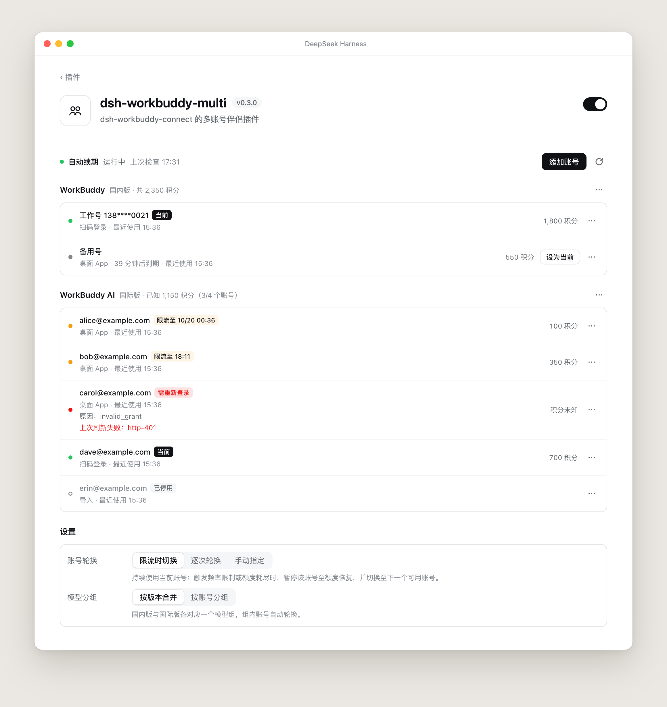
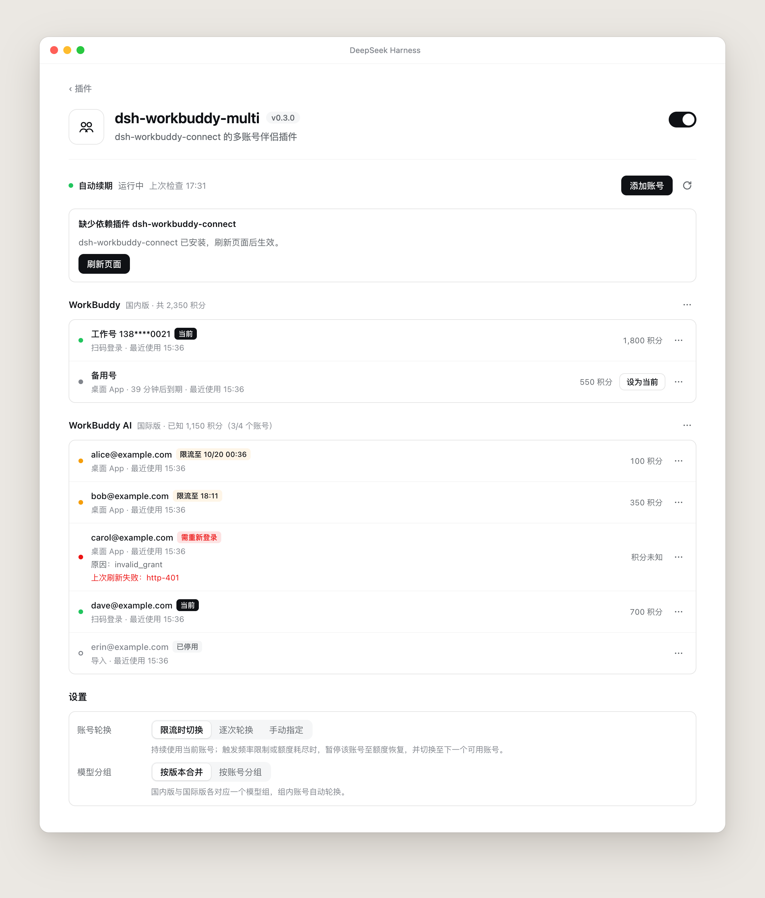
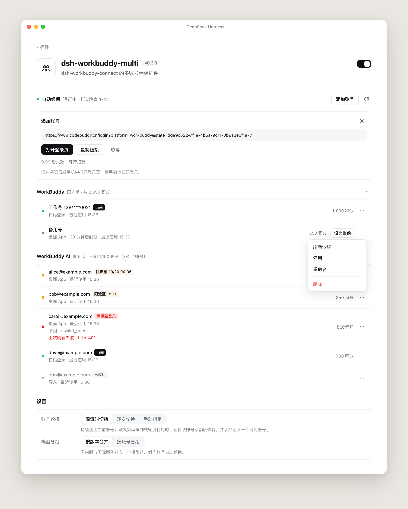
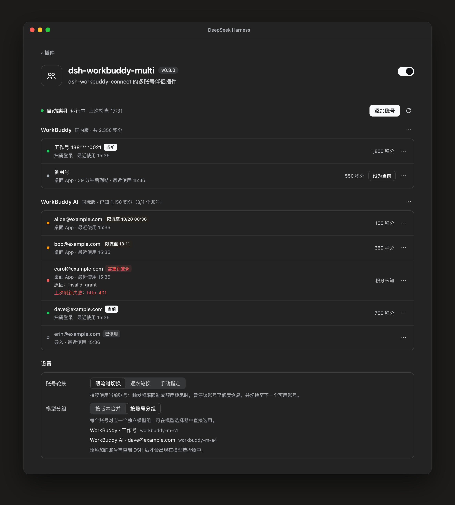

<h1 align="center">dsh-workbuddy-multi</h1>

<p align="center">
  在 DeepSeek Harness 里同时挂多个 WorkBuddy 账号：限流时自动切换、扫码添加、令牌自动续期。
</p>

<p align="center">
  中文 · <a href="README.en.md">English</a>
</p>

<p align="center">
  
</p>

本插件是 [dsh-workbuddy-connect](https://github.com/corrinehu/dsh-workbuddy-connect) 的伴侣插件。
`dsh-workbuddy-connect` 负责把 WorkBuddy 的模型接进 DSH，本插件在它之上管理多个账号，不修改它的任何文件。

## 功能

- **多账号轮换**：国内版、国际版各自维护一个账号池。一个账号触发频率限制或额度耗尽时，暂停到额度恢复的时刻，下一次请求直接使用下一个可用账号，不会再发给限流中的账号。
- **扫码添加账号**：在设置页生成 WorkBuddy 官方登录链接，用微信扫码即可加入账号池；也可以从桌面 App 导入当前登录的账号，或导入授权文件。
- **令牌自动续期**：定时刷新即将过期的令牌；需要重新登录的账号会单独标出。
- **积分合计**：按版本汇总池内所有已启用账号的积分，输入框旁显示合计值。
- **两种分组方式**：按版本合并成一个模型组（组内自动轮换），或每个账号单独一个模型组，在模型选择器里直接选。
- **自动安装依赖**：检测到没有 `dsh-workbuddy-connect` 时，通过插件市场自动安装。

## 安装

**从插件市场安装（推荐）**：打开 DSH 的「插件市场」，搜索 `dsh-workbuddy-multi`，点击安装。

**用命令行安装（dsh web）**：

```sh
dsh plugin --profile web add https://github.com/richardhxwang/dsh-workbuddy-multi/releases/latest/download/dsh-workbuddy-multi.tgz
```

装好后刷新页面，在「插件」页打开 **dsh-workbuddy-multi** 即可看到设置页。

### 依赖会自动安装

本插件需要 `dsh-workbuddy-connect` 才能工作。从插件市场装好本插件后，它会立即检查依赖：如果还没装、或者装了但被停用，会自动通过插件市场安装或启用，并在右下角和设置页里显示进度，完成后按提示刷新页面或重启 DSH。自动安装失败时，提示里会给出原因和「重试」按钮；之后 6 小时内不再自动尝试，期间可随时点「一键安装」。

<p align="center">
  
</p>

没有插件市场时无法自动安装，设置页会给出手动安装的命令：

```sh
dsh plugin add dsh-workbuddy-connect
```

## 使用

### 添加账号

点击右上角「添加账号」，选择国内版或国际版，生成登录链接后在浏览器或手机中打开，用微信扫码。登录成功后账号立即加入账号池。

也可以在每个版本标题右侧的「⋯」菜单里：

- **从桌面 App 导入当前账号**：读取 WorkBuddy 桌面 App 当前登录的账号。
- **导入授权文件**：填写授权文件的路径。

<p align="center">
  
</p>

每个账号右侧的「⋯」菜单提供刷新令牌、停用 / 启用、重命名和删除。「设为当前」只对可用的账号显示。

### 账号轮换

| 方式 | 行为 |
| --- | --- |
| **限流时切换**（默认） | 持续使用当前账号；触发频率限制或额度耗尽时，暂停该账号至额度恢复，并切换至下一个可用账号。 |
| **逐次轮换** | 每个请求依次使用下一个可用账号。 |
| **手动指定** | 不自动切换，只使用手动设为当前的账号。 |

暂停时长优先使用 WorkBuddy 返回的额度恢复时间；返回里没有时间的，默认暂停 30 分钟。

### 模型分组

| 方式 | 行为 |
| --- | --- |
| **按版本合并**（默认） | 国内版、国际版各一个模型组，组内账号自动轮换。 |
| **按账号分组** | 每个账号对应一个模型组，在模型选择器中直接选用。新添加的账号重启 DSH 后才会出现。 |

<p align="center">
  
</p>

## 注意事项

- **不要在 dsh-workbuddy-connect 的设置里填写 auth 文件路径。** 那两项（`authFile` / `authFileAI`）的优先级高于本插件，填了以后自动轮换不会生效。检测到时设置页顶部会提示。
- **国内版账号只能在本机使用。** 国内版的凭据由本机 WorkBuddy App 的密钥加密，账号池拷到别的电脑上无法使用。
- **凭据只保存在本机**：`~/.dsh/workbuddy-pool/`（文件权限 0600）。设置页和接口都不会显示或返回任何令牌。
- 从桌面 App 导入的国内版账号，令牌由 `dsh-workbuddy-connect` 在使用时刷新；想让它也能被自动续期，用「添加账号」扫码登录一次。

## 配置项

一般不需要改。如需调整，在 profile 的 `cordis.patch.yml` 中添加：

```yaml
- id: llm-workbuddy-multi
  config:
    cooldownMs: 1800000      # 无法得知恢复时间时的暂停时长（毫秒）
    keepalive: true          # 令牌自动续期
    keepaliveSweepMs: 900000 # 续期检查间隔
    poolRoot: ''             # 账号池目录，留空为 ~/.dsh/workbuddy-pool
```

## 开发

```sh
npm install
npm test
```

实现细节见 [docs/DESIGN.md](docs/DESIGN.md)。

## 许可

MIT
